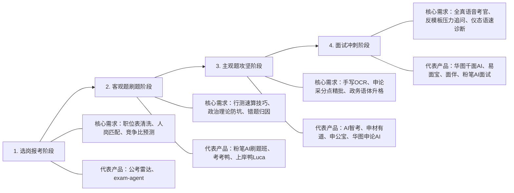

# AI 考公赛道竞品全景调研与 GitHub 考公 AI Skill 深度拆解报告

## 一、 行业背景与 2025–2026 考公 AI 市场新变局

当前中国公职类考试（国考、省考、选调生、事业单位）备考市场已完成从“概念尝鲜”到**“AI 深度渗透”**的过渡。做一款 AI 考公 App，首先来看清当下赛道的三个底层结构性变化：

1. **商业模式重构：高价“协议班”退潮，百元级/订阅制 AI 伴学爆发**
   传统动辄数万元“不过退费”的协议班模式大幅收缩，预算有限的自学党、二战党与在职备考人群迅速转向**数十元/月的垂类 AI 工具**与**数百元的轻量化 AI 刷题班**，工具型需求在错题复盘、申论批改与面试陪练环节尤为集中。
2. **考情结构性剧变：“政治理论”独立成模 + 阅卷“反 AI 模板化”**
   * **行测新增“政治理论”独立模块**（国考及多省省考普遍单设约 20 题）：高度考查近一年重磅文件、会议公报与重要讲话的**“原文原句”与“治国理政逻辑链”**，命题极爱用细微词义替换设坑（如“阶段性”换“根本性”）。
   * **申论与面试全面“反模板化”**：由于大量考生使用通用大模型批量生成同质化范文与面试套话，考官对“假大空”AI 腔产生极强审美疲劳，**结合具体基层治理场景、务实接地气的政务表达**成为高分分水岭。
3. **竞争格局三分天下**
   **传统教培巨头**（题库深厚但包袱重）、**原生垂类 AI 独立应用/小程序**（切单点痛点、高频迭代）、**通用大模型 + 智能体 DIY 生态**（免费灵活但评分标准不稳定）形成既分流又互补的格局。

---

## 二、 现有竞品全景拆解（四大阵营）

### 1. 第一阵营：传统公考教培巨头的 AI 产品矩阵

* **粉笔 App（自研“粉笔头”垂域大模型）**
  * **核心 AI 产品**：**粉笔 AI 刷题系统班**、粉笔 AI 老师（24h 实时答疑与知识点追问）、申论 AI 批改、AI 面试模考大赛。
  * **优势**：坐拥 7000 万+ 注册用户与业内最完备的真题及考生错题轨迹底座，“诊断-推题-模考”闭环流畅，商业化转化率全行业第一。
  * **用户痛点**：申论大作文批改偏机械（过度依赖关键词字面匹配，对高级同义替换识别不足）；App 功能庞杂，无法导入外部渠道错题统一深度复盘。
* **华图在线 App（主打“千面面试 AI”与申论诊断）**
  * **核心 AI 产品**：**千面 AI 面试点评**（高频语音对练、答题逐字稿优化）、申论主观题结构化诊断、知识图谱做题/背题切换。
  * **优势**：依托深厚线下教研基因，在面试季的高频模拟对练与逐字稿润色上口碑突出。
* **高顿教育 / 上岸鸭公考（领扣公考 AI / AI 私教 Luca App）**
  * **核心 AI 产品**：基于 **DKT（深度知识追踪）** 算法将考点拆解至最小颗粒度，生成动态个人课表、能力雷达图与智能组卷。
* **中公教育（中公 AI 就业大模型 / AI 数智系统班） & 腰果公考**
  * 中公侧重虚拟数字人授课、智能选岗及 AI 学习机硬件转型；腰果公考侧重“名师组卷 + 每日 Mini 模考 + 算法推题”的轻社群模式。

### 2. 第二阵营：垂直环节效率霸主（选岗与资料外挂）

* **公考雷达（选岗绝对头部）**
  * **核心功能**：建立个人档案（专业、学历、应届身份、政治面貌、基层年限）后实现**“岗找人”智能匹配**；实时追踪报名与缴费人数、竞争比曲线、历年进面分数线对比；全周期招考日历防漏推送。
* **夸克（备考资料与搜题外挂）**
  * **核心功能**：“深度思考”拆解疑难真题；**夸克扫描王**一键擦除纸质申论/行测试卷手写笔迹还原空白卷；一键 AI 总结《半月谈》、政府工作报告等长篇 PDF 并生成思维导图。

### 3. 第三阵营：原生 AI 垂类 App 与独立开发小程序（App Store / 小红书热门）

* **申论精批与素材垂直类**
  * **AI智考（App / 小程序 / Web）**：主打**“拍照上传手写格子纸 + 30 秒流式批改”**，从采分点、逻辑、错别字、规范表达多维诊断，批改后内置 **AI 教练支持多轮追问**。
  * **申材有道（Web / 小程序 / App）**：绑定 **50 万+ 申论时政金句素材库** 与 AI 批改，解决考生“批改完知道不好，但肚子里没词改”的痛点。
  * **申公宝 / 申论一点通**：主打模拟阅卷人按点给分与微练闭环。
* **AI 模拟面试垂直类**
  * **易面宝（App）**：“AI 考官 10 秒生成多维诊断报告 + 真人老师陪练”双轨制，覆盖结构化面试审题、逻辑与表达。
  * **面伴（App）**：沉浸式结构化面试教练，特色是**根据考生语音回答自动生成思维导图**，直观展示逻辑层次与要点命中缺失。
  * **公考面试间（App）**：1:1 考场计时语音互动，侧重语言流畅度、卡顿口头禅（“然后”、“呃”）监测与仪态反馈。
* **自适应刷题与记忆垂直类**
  * **智蛙公考**：行测 + 申论批改 + AI 面试一站式轻量备考 App。
  * **考考鸭**：结合 **艾宾浩斯遗忘曲线** 循环巩固行测高频易混成语、政治常识与薄弱题型。
  * **行测练题狗**：做完套卷自动针对不会的知识点生成个性化“弱项强化包”。

### 4. 第四阵营：通用大模型与智能体平台（平替 DIY 生态）

* **DeepSeek / 豆包 / Kimi**：小红书主流零成本方案，考生用自定义角色 Prompt 让豆包语音扮演主考官追问，或用 DeepSeek 拆解错题与时评框架。
* **Coze（扣子）公考智能体**：个人教研者将本地真题集、公基背诵手册挂载至 Coze RAG 知识库，串联“抽题 -> 作答 -> 批改 -> 错题记录”工作流。

| 阵营分类 | 代表产品 | 核心护城河 | 主流变现方式 | 核心短板与新机会 |
| :--- | :--- | :--- | :--- | :--- |
| **传统教培巨头** | 粉笔、华图在线、上岸鸭 Luca | 千万级题库与做题统计数据、名师教研体系 | 百元级 AI 刷题班、会员订阅、高阶课程导流 | 产品重、大作文批改机械、缺少跨机构错题导入与名师流派切换 |
| **选岗与效率工具** | 公考雷达、夸克 | 实时招考公告/报名数据爬虫、OCR 与网盘生态 | VIP 选岗会员（年卡/季卡）、网盘/扫描会员 | 缺乏深度“教与练”闭环，选岗与日常刷题割裂 |
| **原生垂类 AI 产品** | AI智考、申材有道、易面宝、面伴、考考鸭 | 单点体验极佳（手写OCR+追问、面试导图）、轻量高频 | 免费体验次数 + 积分加油包 / ¥19.9~49/月会员 | 题库积累薄弱、图形推理等硬核理科模块能力欠缺 |
| **通用大模型 / Agent** | DeepSeek、豆包、Coze 考公 Bot | 推理与语言生成上限高、近乎免费 | C 端免费 / 创作者卖提示词与私域引流 | **缺乏结构化错题本与本地真题联动**，评分标准不稳定 |

---

## 三、 核心功能模块拆解与行业四大技术痛点

### 1. AI 考公 App 的五大标准功能域

1. **智能选岗与考情追踪**：个人画像结构化提取、复杂 PDF/Excel 职位表解析、硬性限制条件零误差过滤、“冲/稳/保”竞争比预测。
2. **行测与政治理论自适应学习**：最小考点颗粒度诊断、分模块限时刷题、**考场实战速算技巧讲解**（而非纯数学硬解）、政治理论原文易混词对比与间隔重复记忆。
3. **申论 / 综应全链路精批**：手写申论方格纸高精度 OCR、给定材料得分点定位、分题型采分批改、机关务实语体升格改写、多轮苏格拉底式追问。
4. **多模态 AI 模拟面试**：结构化/无领导题库、全真语音播报与双倒计时、ASR 语音转写（识别语速、停顿、口头禅）、基于回答漏洞的动态压力追问。
5. **AI 学伴督学与错题复盘账本**：拍照导入纸质卷/外部 App 套卷错题、错因标签归档、**匹配同考点历年真题举一反三**、基于遗忘曲线定时重刷。

### 2. 行业现存四大技术痛点与工程突围方案

* **痛点一：行测“图形推理”是多模态大模型的滑铁卢（裸测准确率仅 30%~60%）**
  * **原因**：公考图推高度依赖交点数、曲直性、一笔画（奇点数）、部分数、立体六面体展开图等精细几何拓扑规则，主流视觉大模型（VLM）直接看图推理极易产生幻觉。
  * **工程解法**：**用户拍照录错题时，支持同时拍入原题答案/解析，或先在本地真题库做图像/题干检索命中标准答案**，再由 AI 基于已知答案反向拆解“图推破题特征信号（比如看到‘日/田’变形优先想一笔画）”，并推荐同考点（如“一笔画专项”）的历年真题图片。
* **痛点二：行测“资料分析”的表格错位与“学院派硬算 vs 考场秒杀技”冲突**
  * **原因**：长截图 OCR 易发生跨列错位；且通用大模型习惯列长算式精确硬算，而公考考场要求 1 分钟内用**截位直除、415 份数法、百化分、混合增长率盐水法**秒杀，同时极易漏看“同比/环比、当月/累计”文字陷阱。
  * **工程解法**：采用高分辨率多模态视觉模型提取图表 + **内置“名师速算方法卡（Method Cards）”约束讲题步骤** + 审题时间/单位陷阱高亮标记。
* **痛点三：申论 AI 批改“机械对词、给分飘忽、范文充满 AI 套话味”**
  * **工程解法**：采用多步证据链工作流（先提取给定资料段落要点清单 -> 考生答案切句语义对齐 -> 确定性规则累加小分 -> 基层公文去套话改写）。
* **痛点四：政治理论与公基的“细微措辞幻觉”**
  * **工程解法**：构建近两年中央重要会议公报、权威文件的精准 RAG 索引库，解析与推题时附上政策原文出处对比。

---

## 四、 GitHub 考公 AI Skill 与开源项目深度总结

在 GitHub 上，围绕 **Agent Skills（`SKILL.md` 规范）**、**MCP Server** 与 **本地优先刷题库**，已有十余个高质量考公开源项目可直接借鉴：

### 1. 全科综合与“名师方法论 Skill 化”代表项目

1. **[KeWang0622/kaogong-skill](https://github.com/KeWang0622/kaogong-skill)（公务员与事业单位 AI 备考全能技能包）**
   * **定位**：覆盖行测、申论、职测、综应、公基、公文、结构化面试与报考策略。
   * **架构亮点**：采用 **`SKILL.md` 轻量总控路由 + `references/` 按需加载专项知识库**（`shenlun.md`、`gongwen.md`、`gongji.md`、`baokao.md`），节省 Token 且强制区分“制度硬伤、材料遗漏、表达建议”，严防幻觉。
2. **[WangJunqing-coder/huasheng13-skill](https://github.com/WangJunqing-coder/huasheng13-skill) & [WangJunqing-coder/shenlun-skill](https://github.com/WangJunqing-coder/shenlun-skill)（公考名师流派 AI 技能库）**
   * **定位**：将头部公考名师公开教学方法论结构化封装为 Agent Skill。
   * **架构亮点**：
     * `huasheng13-skill` 将“花生十三”的**资料分析 ABRX 体系、415 份数法、假设分配法、截位直除**以及判断/数量技巧沉淀为标准推理步骤，让 AI 用考场实战速算语言讲题。
     * `shenlun-skill` 整合李梦圆、小马哥等申论名师体系，覆盖五大题型、15 种公文格式与上百条规范政务词条。
3. **[master-skill/prototypes](https://github.com/master-skill/prototypes)（`civil-service-exam-prep-master`）**
   * **定位**：封装公考导师心智模型、决策树规则与辅导工作流原型。

### 2. 单科深度复盘与结构化面试专项 Skill

4. **[liuyuexi1987/xingce-review-pro](https://github.com/liuyuexi1987/xingce-review-pro)（行测复盘一体版 Skill）**
   * **定位**：专注行测五大模块的讲题、方法训练与**结构化状态写回**。
   * **架构亮点**：将“讲题方法卡”与“考生弱点档案状态管理”解耦，每次复盘后自动更新用户的薄弱题型标签与错因统计——**非常适合直接作为个人错题本 App 的核心 Prompt 引擎**。
5. **[liuyuexi1987/shenlun-review-pro](https://github.com/liuyuexi1987/shenlun-review-pro)（申论复盘一体版 Skill + MCP）**
   * **核心工作流**：拆清题干审题要素 -> 回归给定材料逐段建立得分锚点 -> 对照参考答案校准尺度 -> 分档赋分并输出示范修改。
6. **[pm-claude-skills/skills](https://github.com/pm-claude-skills/skills)（含 `cn-civil-exam-essay` 与 `cn-civil-exam-interview`）**
   * **核心机制**：申论端采用“命中点 / 遗漏点 / 冗余跑偏点”三栏阅卷法；面试端支持计时模拟与反套路点评。

### 3. 备考追踪、题库生成与智能选岗 Agent 工具链

7. **[KaguraNanaga/kaogong-study-tracker](https://github.com/KaguraNanaga/kaogong-study-tracker)（考公备考“朱批录”追踪 Skill）**
   * **玩法**：把模考成绩单或错题截图发给 Agent，自动完成识图归档、弱点趋势分析、错题本整理与定期复习提醒。
8. **[Why-com-ui/gongkao-practice.skill](https://github.com/Why-com-ui/gongkao-practice.skill)（公考智能出题与题库标准化 Skill）**
   * **亮点**：“规则文档 + 参考真题库 + Python 校验脚本”模式，能把散乱的 Markdown/Excel/CSV 资料清洗为统一 JSONL 结构，并按模块生成高仿真练习。
9. **[hf007019-lgtm/exam-agent](https://github.com/hf007019-lgtm/exam-agent) & [HA7CH/kaogong-pro](https://github.com/HA7CH/kaogong-pro)**
   * 招考职位表复杂 Excel 清洗进本地 SQLite 与“冲/稳/保”选岗推荐 Agent。

### 4. 开源公考刷题系统与可直接复用的真题库底座

10. **[ERRRC/kaogong-shuati](https://github.com/ERRRC/kaogong-shuati) & [ERRRC/xingcezhenti](https://github.com/ERRRC/xingcezhenti)**
    * 开源跨端（Web + Android）考公刷题应用，内置多模态 OCR 识图与行测速算解析；**`ERRRC/xingcezhenti` 收录了 2016–2026 年国省考海量行测真题语料，可直接作为个人自用 App“推荐类似真题”的数据底座**。
11. **[jangviktor-web/GongkaoNaoku](https://github.com/jangviktor-web/GongkaoNaoku)（公考脑库）**
    * 基于 **SM-2 间隔重复算法**的本地优先公考真题系统，整合了数万道全国各省市行测真题库与错题记忆逻辑。
12. **[jiangqiang1996/ai-agent-gwy](https://github.com/jiangqiang1996/ai-agent-gwy) & [0xminmin2025/gongkao-ai-guide](https://github.com/0xminmin2025/gongkao-ai-guide)**
    * 前者为 Multi-Agent 考点梳理与例题精讲系统；后者为开源的公考 AI 全链路评测指南。

---

## 五、 面向“个人自用错题本 + 同类真题推荐”App 的技术转化启示

结合上述调研与 GitHub 开源生态，个人自用 Android App 可以直接吸收以下五大精华设计：

1. **零后端纯本地架构（Offline-First + 直连大模型 API）**：无需部署云服务器或备案，真题库与个人错题本全部存储在手机本地 SQLite（支持一键备份导出），AI 解析与多模态识图直接由 App 调用配置好的大模型 API Key。
2. **真题库底座直接复用开源资产**：将 `ERRRC/xingcezhenti` / `GongkaoNaoku` 的历年国省考真题预置（或按需导入）到 App 本地数据库中，预先构建**“三级考点标签树 + 全文检索（FTS5）/ 语义向量索引”**，确保“推荐类似真题”推出来的是百分百高质量历年真题，而非大模型胡编的劣质模拟题。
3. **拍照录题双模式防翻车**：支持“单拍错题”与“错题+原答案截图同传”（针对图形推理等视觉高难模块，直接传入正确答案让 AI 专注提炼破题特征与秒杀口诀，彻底规避 AI 算错答案误导自己）。
4. **植入名师方法卡（Method Cards）**：借鉴 `huasheng13-skill` 与 `xingce-review-pro`，在本地内置各题型的实战速算/秒杀 Prompt 卡，识图判定题型后动态注入对应方法卡。
5. **SM-2 遗忘曲线重刷闭环**：借鉴 `GongkaoNaoku`，错题与推荐的同类真题做完后自动进入间隔重复队列，每日打开 App 先清“今日待复习错题”。
