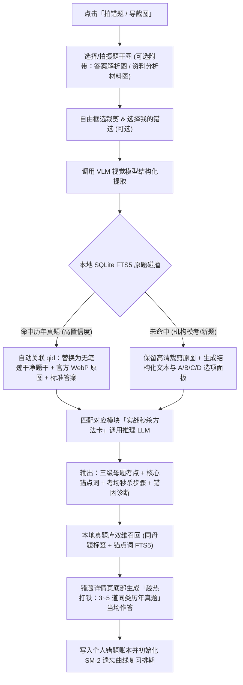

# 个人版 AI 考公错题复盘与同类真题推荐 App 设计方案

> **文档定位**：基于前期竞品调研、GitHub 考公 AI Skill 拆解及需求访谈（`/grill-me`）达成的完整产品与工程技术共识，作为后续编码实现的直接蓝图。

---

## 一、 核心定位与设计决策总览

| 决策维度 | 最终敲定方案 |
| :--- | :--- |
| **产品性质** | 个人自用普通 Android App（无需商用备案/支付/审批，离线优先 Local-First，零服务器运维成本） |
| **首期科目** | 公考 **行测六大模块**（政治理论、常识判断、言语理解与表达、数量关系、判断推理、资料分析），表结构预留申论扩展 |
| **录题输入** | **纸质卷实拍 + 粉笔等 App 截图导入**双支持；支持自由裁剪；支持**「题干图 + 答案/解析图」同传**防 AI 算错答案；支持资料分析「共享材料图 + 单/多道错题」绑定 |
| **错题卡片还原** | **智能双轨还原**：① 识图文本命中本地真题库时，自动替换为库内**无手写笔迹高清原题 + WebP 原配图**；② 外部模考题未命中时，保存为**裁剪原图 + 结构化可交互 A/B/C/D 选项面板** |
| **同类真题推荐** | **「三级母题考点树 + 核心锚点词」双维混合检索**：资料/数量/判断按底层公式与推理规则推真题，言语/政治理论额外支持按同一易混成语或政策专题词精准追击；录完即可当场练 3~5 道历年真题 |
| **AI 模型与讲题** | 自定义 BaseURL / API Key（兼容 **OpenAI 格式** 与 **Gemini 原生接口**），支持单全能多模态模型或「VLM 识图 + DeepSeek 等推理讲题」双模型组合；内置**考场实战速算/秒杀方法卡** |
| **复习与导出** | **SM-2 遗忘曲线「今日待复习」队列** + 遮挡答案计时重做 + 多维筛选 + **一键导出无答案刷题 PDF** + 本地数据包导入导出备份 |
| **技术栈与打包** | **React Native (Expo + TypeScript)** + `expo-sqlite` (FTS5) + Python 真题包构建脚本；日常用 **Expo Go** 真机扫码调试，独立安装包由 **GitHub Actions** 云端自动编译输出 `.apk` |

---

## 二、 核心业务工作流设计

### 1. 拍照录错题 -> 双轨还原 -> 实战讲题 -> 当场推真题闭环



### 2. 内置公考实战 Skill 方法卡体系（吸收 GitHub 开源 Skill 精髓）

参考 `WangJunqing-coder/huasheng13-skill`、`KeWang0622/kaogong-skill` 与 `liuyuexi1987/xingce-review-pro`，采用**“轻量路由 + 模块专属方法卡按需注入”**设计，杜绝学院派啰嗦硬算：

* **`cards/ziliao_fenxi.md`（资料分析方法卡）**：强制先标出**时间范围/统计指标/单位陷阱**（如同比 vs 环比、累计 vs 当月），列式后优先给出**截位直除、415 份数法、假设分配法、百化分、混合增长率（盐水法）、两期比重差秒杀口诀**，拒绝多位小数硬除。
* **`cards/panduan_tuili.md`（判断推理方法卡）**：
  * **图形推理**：若已传入答案或命中原题，重点反向提炼**“考场第一眼特征信号”**（如“出现日/田字变形及多端点 -> 秒想奇点数一笔画”、“黑白块数量多且扎堆 -> 看黑白部分数”）。
  * **逻辑判断**：明确区分论点与论据，按**搭桥/拆桥、因果倒置、他因削弱、必要条件假言命题逆否等价**拆解。
* **`cards/yanyu_lijie.md`（言语理解方法卡）**：中心理解题抓转折/因果/必要条件主题词；逻辑填空题抓**对应词句锚点**，并对四个选项的**高频易混成语/实词做侧重点对比辨析**（自动提取成语写入锚点词索引）。
* **`cards/shuliang_guanxi.md`（数量关系方法卡）**：优先检验能否用**奇偶特性、倍数整除特性、代入排除法、特值赋值法**秒杀，其次再给基础方程解，并给出考场取舍建议（是否为 1 分钟内必拿分题）。
* **`cards/zhengzhi_changshi.md`（政治理论与常识方法卡）**：聚焦权威表述中的**细微概念偷换坑**（如“根本保证 / 必由之路 / 战略支撑 / 首要任务”精准对应），梳理治国理政逻辑链。

---

## 三、 数据库设计（双 SQLite 库物理分离架构）

借鉴 `GongkaoNaoku` 最佳实践，将只读的庞大真题库与珍贵的个人错题数据拆分为两个独立的 SQLite 数据库文件，升级题库绝不覆盖个人错题记录：

### 1. 只读真题底座库：`question_bank.db`
支持内置精选种子库（Seed DB，约数百道高频代表性真题，安装即用）+ 随时从手机文件管理器一键导入由 Python 脚本生成的全量 6 万题数据包。

* **`real_questions`（历年真题主表）**
  * `qid` (TEXT PRIMARY KEY)：稳定唯一题号
  * `source_exam` (TEXT)：来源卷名，如 `2025年国家公务员考试《行测》（副省级）`
  * `year` (INTEGER)：年份（优先推荐近 5 年真题）
  * `province` (TEXT)：国考 / 联考 / 江苏 / 广东 / 浙江 / 山东等
  * `module_l1` (TEXT)：一级模块（政治理论 / 常识判断 / 言语理解 / 数量关系 / 判断推理 / 资料分析）
  * `category_l2` (TEXT)：二级题型（如 `逻辑填空`、`图形推理`、`比重问题`）
  * `mother_type_l3` (TEXT)：三级母题考点（如 `两期比重差`、`对称轴方向与数量`、`因果倒置削弱`）
  * `material_id` (TEXT, NULLABLE)：资料分析/篇章阅读共享材料 ID
  * `material_text` (TEXT, NULLABLE) & `material_images_json` (TEXT)：共享文字或图表相对路径列表
  * `stem` (TEXT)：题干文本
  * `stem_images_json` (TEXT)：题干配图列表（本地 WebP 路径）
  * `options_json` (TEXT)：`[{"key":"A","text":"...","image":null}, ...]`
  * `answer` (TEXT)：标准答案（如 `C`）
  * `official_analysis` (TEXT)：官方/基础解析
  * `anchor_keywords` (TEXT)：空格分隔的核心锚点词（成语、政策热词、公式特征词）
* **`real_questions_fts`（FTS5 全文检索虚表）**
  * 索引字段：`stem`, `options_json`, `anchor_keywords`, `mother_type_l3`（用于 ① 拍照原题秒级碰撞匹配；② 易混成语/政策词毫秒级同类召回）。

### 2. 个人错题与学习状态库：`user_notebook.db`

* **`mistakes`（我的错题主表）**
  * `id` (TEXT PRIMARY KEY, UUID)
  * `matched_qid` (TEXT, NULLABLE)：若命中本地真题库则关联 `qid`
  * `capture_images_json` (TEXT)：手机本地保存的裁剪题干图、材料图、原解析附图路径
  * `module_l1`, `category_l2`, `mother_type_l3` (TEXT)：三级母题归属（支持手动微调）
  * `anchor_keywords_json` (TEXT)：AI 提取的核心锚点词数组
  * `stem_text`, `material_text`, `options_json`, `correct_answer`, `my_wrong_answer`
  * `error_reason` (TEXT)：错因分类（`审题掉坑` / `公式方法不熟` / `概念成语混淆` / `图推特征盲区` / `纯粗心算错` / `耗时过长`）
  * `ai_fast_solution` (TEXT)：实战秒杀解析（Markdown）
  * `ai_chat_history_json` (TEXT)：针对该错题的追问对话历史
  * `user_note` (TEXT)：个人一句话复盘心得
  * **SM-2 间隔重复字段**：`repetitions` (INT), `easiness_factor` (REAL, 默认 2.5), `interval_days` (INT), `next_review_at` (INTEGER 时间戳), `last_time_spent_sec` (INT), `mastery_status` (`learning` / `reviewing` / `mastered`)
  * `created_at`, `updated_at` (INTEGER)
* **`practice_logs`（错题重刷与同类真题作答流水表）**
  * `id`, `target_type` (`mistake` | `real_question`), `target_id`, `source_mistake_id` (由哪道错题推荐触发), `selected_answer`, `is_correct`, `time_spent_sec`, `created_at`

---

## 四、 同类真题双维推荐算法（On-Device Recommendation Engine）

当一道错题完成解析后，本地推荐引擎无需额外消耗大模型 Token 即可在 **< 50ms** 内给出高相关性真题推荐，评分排序公式如下：

1. **候选池召回（Recall）**：
   * **路径 A（母题精确召回）**：查询 `real_questions` 中 `module_l1` 与 `mother_type_l3` 完全一致的真题（排除自身 `matched_qid` 及近期已做对真题）。
   * **路径 B（锚点词 FTS5 召回）**：针对言语填空（高频成语）、政治理论/常识（政策热词）、判断类比等，使用 `real_questions_fts MATCH anchor_keywords` 召回包含相同核心考点词的真题。
   * **路径 C（二级题型兜底召回）**：若路径 A+B 不足 5 道，退化至同一 `category_l2` 下按关键词重合度召回。
2. **加权排序（Ranking）**：
   $$\text{Score} = 50 \times \mathbb{I}(\text{同三级母题}) + 35 \times (\text{命中锚点词数}) + 15 \times \text{年份新鲜度权重}(2022\text{–}2026\text{优先}) - 40 \times \mathbb{I}(\text{已刷过且正确})$$
3. **前端双模式切换**：
   * Tab 1：**「练同母题模型」**（适合资料分析、数量、逻辑、图推固化肌肉记忆）
   * Tab 2：**「追同成语 / 同考点词」**（适合言语理解一网打尽同一个高频成语的历年考法，或政治理论串联同一文件考法）

---

## 五、 页面结构与交互规划（4 个极简主 Tab）

1. **首页「今日复盘」**
   * 顶部核心卡片：**今日待复习错题数（SM-2 到期）** + 一键开启「沉浸式遮挡答案计时重刷」。
   * 中部快捷大按钮：**📷 拍错题 / 导相册截图**（一触即达，支持选单题/资料分析连体题、附答案图）。
   * 底部弱点热力看板：六大模块高频错题 Top 5 三级母题排行与常见错因占比。
2. **「错题本」**
   * 支持按 **六大模块、三级母题考点、错因标签、掌握状态、关键词搜索** 组合过滤。
   * 支持多选批量勾选错题（可勾选“顺带附每道错题的 2 道同类真题”）-> **一键导出无答案刷题 PDF**（自动排版题干、配图、留白演算区，答案解析统一置于文档末尾）。
3. **「真题库」**
   * 可直接按模块/考点树/年份检索浏览本地历年真题、查看已导入题库规模，随时拉起 5~10 道专项小练。
4. **「设置与数据」**
   * **AI 模型配置**：预设常用模板（Gemini、硅基流动/百炼 Qwen-VL + DeepSeek、OpenRouter、自定义 OpenAI 兼容接口），支持单模型或「视觉模型 + 推理模型」分离配置及一键连通性测试。
   * **讲题偏好**：默认开启「公考实战秒杀流派」。
   * **离线真题包管理**：查看内置种子题库状态，一键从手机本地文件导入全量 `.db` / 图包。
   * **安全备份与恢复**：一键将 `user_notebook.db` + 实拍错题图片打包导出为 `.zip` 备份文件（或从备份文件恢复）。

---

## 六、 项目目录结构与分阶段开发路线

```text
/Users/wangshaocong/Code/ai考公/
├── docs/                                   # 调研与架构设计文档
│   ├── 01-AI考公竞品与GitHub-Skill调研报告.md
│   └── 02-个人版AI考公错题复盘App架构与设计方案.md
├── app/                                    # Expo (React Native + TypeScript) 移动端工程
│   ├── app/                                # Expo Router 页面路由 (首页/拍题/错题本/真题库/设置)
│   ├── src/
│   │   ├── db/                             # 双 SQLite 数据库封装、FTS5 检索、Seed 种子库初始化
│   │   ├── ai/                             # OpenAI/Gemini 多模态客户端 + 内置实战秒杀方法卡 (Method Cards)
│   │   ├── engine/                         # 原题碰撞匹配器、同类真题双维推荐引擎、SM-2 遗忘曲线算法
│   │   ├── services/                       # 拍照裁剪存储、无答案刷题 PDF 导出、本地 ZIP 备份导入导出
│   │   ├── components/                     # 题目卡片(图文双轨)、答题面板、相似真题抽屉、解析渲染器
│   │   └── taxonomy/                       # 公考行测六大模块标准三级母题考点树定义
│   └── package.json
├── scripts/                                # Python 3.12 离线真题库转换与打包工具链
│   ├── build_question_pack.py              # 将开源真题仓库 (ERRRC/xingcezhenti 或 GongkaoNaoku) 清洗构建为标准离线包
│   └── generate_seed_db.py                 # 生成 App 开箱即用的内置六大模块精选真题种子库
└── .github/
    └── workflows/
        └── build-android-apk.yml           # GitHub Actions 云端自动编译 Android Release APK 工作流
```

### 实施分期计划（Roadmap）

* **Phase 1：工程骨架、双库底座与内置种子真题库**
  初始化 Expo TypeScript 工程；定义行测六大模块三级母题考点树；实现双 SQLite 数据库（含 FTS5 全文索引）与精选种子真题库初始化；跑通真题浏览与基础交互面板。
* **Phase 2：多模态拍照录题、双轨还原与实战方法卡 AI 引擎**
  实现拍照/相册选图裁剪（支持附图传答案、资料分析材料图关联）；接入 OpenAI/Gemini 兼容多模态接口；内置六大模块秒杀方法卡 Prompt；打通“本地原题碰撞替换 vs 裁剪图保存”智能双轨还原。
* **Phase 3：同类真题双维推荐与当场练习闭环**
  实现「三级母题 + 核心锚点词」双维推荐评分引擎；完成错题详情页底部「趁热打铁练真题」抽屉、多轮 AI 追问与错因编辑。
* **Phase 4：SM-2 遗忘曲线重刷、无答案 PDF 导出、备份与云端 APK 打包**
  实现首页 SM-2 今日待复习沉浸式计时重做、批量导出无答案刷题 PDF、本地数据包/备份包导入导出；编写 Python 全量开源真题转换脚本与 GitHub Actions 自动构建 APK 工作流。
